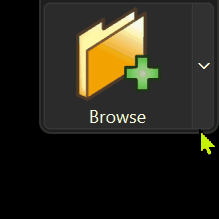
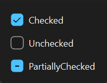
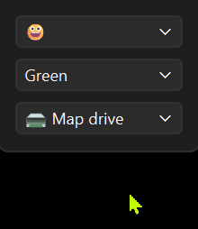
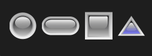
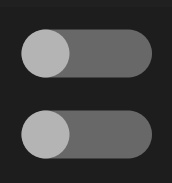

# Overview

Custom [Qt] components for the graphical user interface (GUI).

The [prompt][] module provides functions to create a window to either notify the user of an event that happened or to request input from the user. The functions are also convenient in scripts, not just in a GUI application.

```python
from msl.qt import DEGREE, prompt

angle = prompt.number(f"Enter an angle [{DEGREE}]", minimum=0, maximum=360)
```

The following widgets are provided, plus all of the [widget classes](https://doc.qt.io/qt-6/widget-classes.html) from [Qt] are available.

<table>
  <tr>
    <th>Widget</th>
    <th>Description</th>
    <th>Example</th>
  </tr>
  <tr>
    <td><a href="api/widgets/button">Button</a></td>
    <td>A button to display text, an icon and a menu. The button supports a left-click and a right-click event.</td>
    <td></td>
  </tr>
  <tr>
    <td><a href="api/widgets/checkbox">CheckBox</a></td>
    <td>A checkbox with a text label. A checkbox can be in either the checked, unchecked or partially-checked state.</td>
    <td></td>
  </tr>
  <tr>
    <td><a href="api/widgets/combobox">ComboBox</a></td>
    <td>A combobox to select an item from a list of items. An item can include text, an icon and user data.</td>
    <td></td>
  </tr>
  <tr>
    <td><a href="api/widgets/led">LED</a></td>
    <td>An LED (i.e., light-emitting diode) to signify two states &mdash; <i>on</i> and <i>off</i>.</td>
    <td></td>
  </tr>
  <tr>
    <td><a href="api/widgets/line_edit">LineEdit</a></td>
    <td>Editable text that can rescale the font size based on the widget size.</td>
    <td></td>
  </tr>
  <tr>
    <td><a href="api/widgets/toggle_switch">ToggleSwitch</a></td>
    <td>A toggle switch to signify two states &mdash; <i>on</i> and <i>off</i>.</td>
    <td></td>
  </tr>
</table>


## Install
`msl-qt` is available at the [Python Package Index](https://pypi.org/project/msl-qt/). It can be installed using a variety of package managers

=== "pip"
    ```console
    pip install msl-qt
    ```

=== "uv"
    ```console
    uv add msl-qt
    ```

=== "poetry"
    ```console
    poetry add msl-qt
    ```

=== "pdm"
    ```console
    pdm add msl-qt
    ```

### Dependencies
* Python 3.8+
* [PySide6] or [PyQt6] &mdash; you can chose which Python binding you want to use

You can install one of these Python bindings for the Qt Framework when `msl-qt` is installed.

For [PySide6],

=== "pip"
    ```console
    pip install msl-qt[PySide6]
    ```

=== "uv"
    ```console
    uv add msl-qt[PySide6]
    ```

=== "poetry"
    ```console
    poetry add msl-qt[PySide6]
    ```

=== "pdm"
    ```console
    pdm add msl-qt[PySide6]
    ```

or for [PyQt6]

=== "pip"
    ```console
    pip install msl-qt[PyQt6]
    ```

=== "uv"
    ```console
    uv add msl-qt[PyQt6]
    ```

=== "poetry"
    ```console
    poetry add msl-qt[PyQt6]
    ```

=== "pdm"
    ```console
    pdm add msl-qt[PyQt6]
    ```

!!! note
    The `msl-qt` package is not meant to be used as an general purpose abstraction layer for PyQt5, PySide2, PyQt6 and PySide6.
    You may want to consider using [qtpy](https://github.com/spyder-ide/qtpy) if that is what you are looking for.
    Only some [Qt] modules and classes are abstracted (for PyQt6/PySide6) to provide a uniform interface (see [API](api/index.md)).


## Type Checker Integration

If you are using [mypy] or [pyright]/[pylance] to check your code for type annotations, you can configure these tools to use the particular binding ([PySide6] or [PyQt6]) that you are using. Two constants are defined in the `msl-qt` package: `PYSIDE6` and `PYQT6` (of type [bool][]). You configure these tools by defining one constant as `true` and the other as `false`.

### mypy

For the mypy configuration example we show `PYQT6` as `true`, but enable the binding you are using.

=== "mypy.ini"
    ```ini
    [mypy]
    always_true = PYQT6
    always_false = PYSIDE6
    ```

=== "pyproject.toml"
    ```toml
    [tool.mypy]
    always_true = ["PYQT6"]
    always_false = ["PYSIDE6"]
    ```

=== "cli"
    ```console
    mypy --always-true=PYQT6 --always-false=PYSIDE6 ...
    ```

### pyright

For the pyright configuration example we show `PYSIDE6` as `true`, but enable the binding you are using.

=== "pyrightconfig.json"
    ```json
    {
        "defineConstant": {
            "PYQT6": false,
            "PYSIDE6": true
        }
    }
    ```

=== "pyproject.toml"
    ```toml
    [tool.pyright]
    defineConstant = { PYQT6 = false, PYSIDE6 = true }
    ```

[Qt]: https://www.qt.io/
[PySide6]: https://doc.qt.io/qtforpython-6/
[PyQt6]: https://www.riverbankcomputing.com/software/pyqt/
[mypy]: https://mypy.readthedocs.io/en/stable/index.html
[pyright]: https://microsoft.github.io/pyright
[pylance]: https://marketplace.visualstudio.com/items?itemName=ms-python.vscode-pylance
